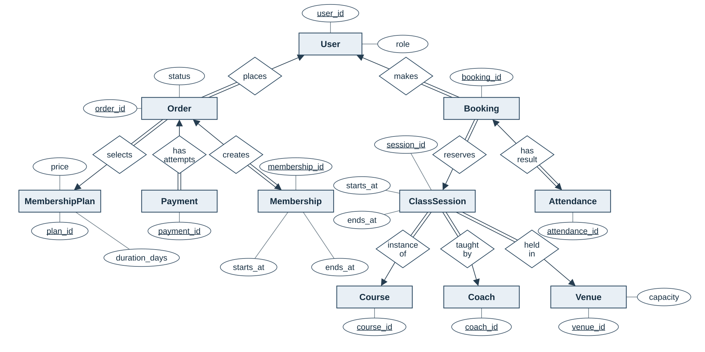

# Fitness Center Membership & Class Booking System

Problem Description and Draft ER Model

Group10

## 1. Problem and objectives

This project proposes a membership and group-class booking system for a fitness center. In a setting where member details, purchases, class schedules and attendance are recorded separately, staff must repeatedly reconcile information, while members have limited visibility of their eligibility and available classes. This can lead to inconsistent membership records, duplicate or over-capacity bookings, and conflicting coach or venue assignments. The system aims to connect these records, support member self-service and give administrators a consistent basis for scheduling and operational queries.

## 2. Motivation

We selected this topic because its everyday workflows are easy to explain, yet involve substantial database-design challenges. Purchases, membership periods, shared resources and many-to-many class bookings provide a meaningful setting for entity–relationship modelling, normalization and integrity constraints. Competition for the last place and repeated payment requests also motivate later work on transactions, concurrency and idempotency.

## 3. Scope and information to model

The first version covers one center with multiple training venues and two login roles: Member and Admin. Coaches are managed resources rather than a separate login role. The database will model user accounts, versioned membership plans, orders, payment attempts, purchased membership periods, coaches, venues, course types, scheduled class sessions, bookings and attendance. Operational summaries will be derived from these records. A dynamic website with at least ten pages is planned for XAMPP/Apache, using PHP and MySQL/MariaDB.

## 4. Planned features

- Accounts: register, log in and maintain a personal profile; administrators manage member status.
- Membership purchase and renewal: select a plan, create an order, confirm simulated/offline payment and create a traceable validity period.
- Scheduling: maintain courses, coaches and venues, then publish sessions after checking resource conflicts and capacity.
- Booking and cancellation: check membership coverage, availability and time conflicts; confirm or cancel a booking under defined rules.
- Attendance: record check-in and finalize absence after a class, keeping attendance distinct from reservations.
- Queries and reporting: view personal histories and administrator summaries of successful sales, class popularity and attendance.
## 5. Core assumptions

One order purchases one immutable plan version and is paid in full through simulation or administrator-confirmed offline collection. A successful purchase creates one membership period; renewal preserves previous periods. Plans have fixed durations and equivalent class-booking rights. Each session has one course, one coach and one venue. Real payment gateways, refunds, private coaching and multi-center operations are outside this version.

<!-- PAGE BREAK -->

## Draft ER Diagram — Chen Style

Rectangles: entities; diamonds: relationships; ellipses: attributes; underlined attributes: keys. Selected attributes are shown.

Arrow toward an entity: at most one. No arrow: many. Double line: total participation. Single line: partial participation.

### Additional business constraints

- Purchases and bookings are member-only. An order may have multiple payment attempts but at most one success; settlement and period creation must be atomic.
- Membership ownership and plan are derived through the source order. Plan price and duration are fixed once referenced by an order; this version derives the full purchase amount from that plan.
- Paid periods must continuously cover the entire session; adjacent renewals may jointly provide coverage. Confirmed bookings cannot exceed capacity; member, coach and venue times cannot overlap.
- At most one booking exists per member–session pair. A booking may have no attendance result before class completion; an absence has no check-in time.
