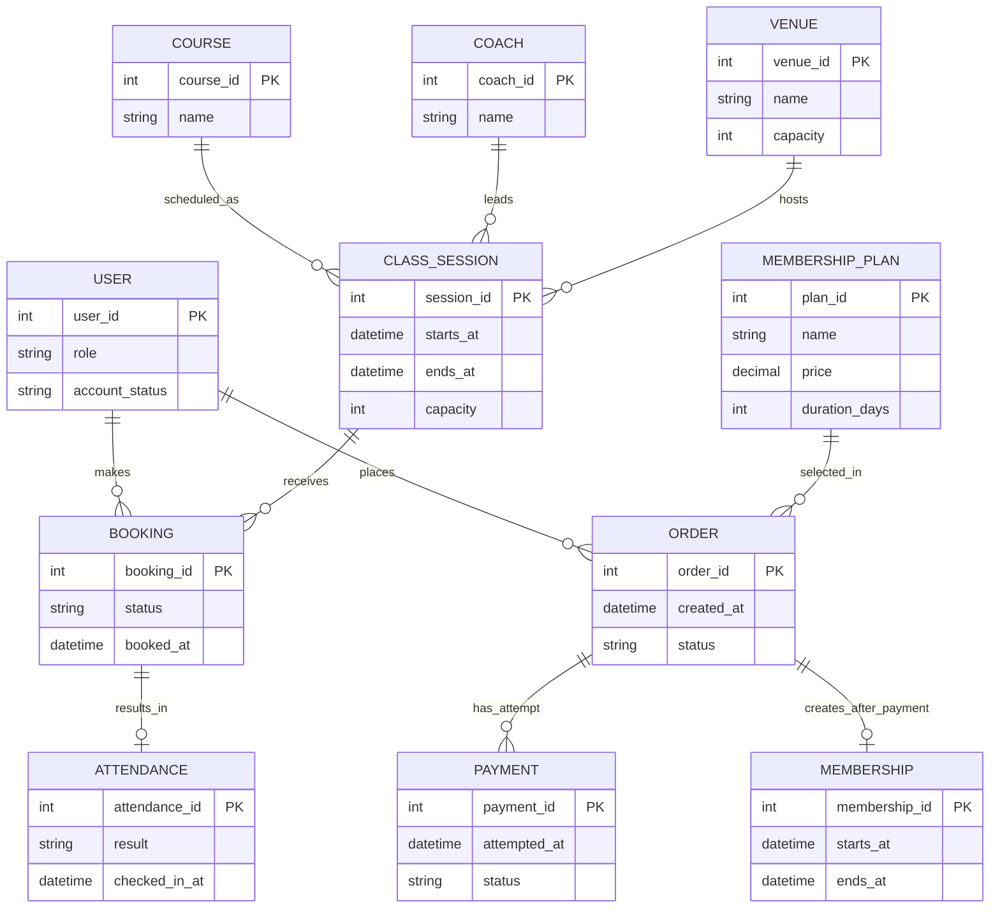

# T01：11 月 21 日第一次提交——任务解析、模型完善与组员指南

> 版本：v1.1，2026-11-15  
> 课程：COMP3013 Database Management System，2026 Fall  
> 项目：Fitness Center Membership and Class Booking System  
> 对应阶段：问题描述与 ER 图初稿  
> 阅读对象：全体组员，以及承担后续任务的 Codex。  
> 本文件是组内详细指南，含用于讨论的 ER 草案；不是已经排好版、可以直接提交的 1–2 页成品。

后续产出：[两页 Word 文字表格版](../submissions/first_submission/COMP3013_26F_GroupXXX_First_Submission.docx)已生成并完成试转 PDF 检查；填写组号成员、ER 形式和最终导出检查见 [Word 任务说明](T01_Word_Draft.md)。

相关文档：[项目总框架](../../Requirement.md) · [分工与阶段计划](../../Workflow_and_Team_Plan.md)。本次应先读本文件第 1–4 节理解任务，再读第 5–9 节评审模型，最后按第 10–13 节执行。

## 1. 老师究竟要求我们交什么

老师在主要求第 4 页写道：

> Nov. 21 - problem description and the first draft of the ER diagram about 1–2 pages long. You should define the problem that you are solving, why you are interested in this problem, the information that you want to model in your system, and the features that your system will include.

**核心任务：用简明的问题描述和一张可读的 ER 初稿，让读者判断“选题是否明确、数据模型能否支持计划功能”。**

| 原文要点 | 应回答的问题 | 我们应提供的内容 | 常见不足 |
|---|---|---|---|
| problem description | 谁面临什么具体问题？ | 健身中心会员、管理员的管理难点及项目目标 | 只写“做一个健身网站” |
| why interested | 为什么选择这个问题？ | 真实选题动机，以及场景与数据库课程的契合点 | 编造访谈、调查数据或亲身经历 |
| information to model | 系统需要记住哪些业务事实？ | 实体、主要属性、联系与关键规则 | 只有网页清单，没有数据结构 |
| features | 用户能完成哪些任务？ | 购买续费、排课、预约取消、签到统计等完整流程 | 把按钮、页面和业务流程混为一谈 |
| first draft of ER | 这些事实之间如何关联？ | ER 图、实体标识、联系名称、基数和必要假设 | 只列实体名称，或只有几根无含义连线 |
| about 1–2 pages | 能否在有限篇幅内讲清楚？ | 精简文字与清晰图示 | 把整份总框架直接交上去，或缩小字体塞满内容 |

暂按“问题描述与 ER 合计约 1–2 页”规划，这是对原文的保守执行方式；原文没有在这句话中明确附件拆分、文件扩展名或语言要求，最终以 iSpace／老师最新通知为准。

主要求第 2 页另规定整个项目至少八个实体、六个联系。初稿就按该规模设计，减少后续返工；这不是把完整数据库实现提前变成第一次提交要求。

## 2. 本次交付与组内资料分开

| 内容 | 11 月 21 日提交稿应体现 | 组内需要保留 |
|---|---|---|
| 问题、动机、目标、范围 | 简洁说明 | 详细理由、取舍、问题清单 |
| 信息与功能 | 核心信息类别和四条以上完整流程 | 全部功能清单、规则、页面映射 |
| ER 初稿 | 一张可读图及简要图例／假设 | 可编辑源、逐实体与联系解释、评审记录 |
| 规范化、事务、性能 | 可简述设计目标 | 后续详细任务；这次不要求完整证明或测试结果 |
| 网站、SQL、PPT | 这次交付清单未要求 | B、C 组可同步准备，不混入短稿挤占篇幅 |

建议最终形成两页：第一页介绍问题与范围，第二页放 ER 图和关键假设。组内详细文档不限于两页。本文件中的草图和文字可以作为下一步输入，但仍需组内评审、压缩、导出和检查可读性。

## 3. 将健身中心选题定义得足够具体

### 3.1 一句话范围

为**一个具有多间训练场地的健身中心**建立会员与团体课程预约管理系统，统一管理账号、会籍销售、教练与排课、预约取消、出勤及运营查询。

### 3.2 优先说明的五个问题

| 问题 | 对谁有影响 | 数据层面的原因 | 计划改进 |
|---|---|---|---|
| 会籍及到期信息难核对 | 会员、管理员 | 购买、付款、有效期记录分散 | 把订单、付款结果和会籍周期关联 |
| 课表与名额难查询 | 会员 | 课程介绍与实际场次未统一 | 查询具体日期、教练、场地和容量 |
| 重复、超额或冲突预约 | 会员、管理员 | 缺乏统一记录与跨记录校验 | 明确预约关系、容量和时间规则，后续用约束与事务落实 |
| 教练或场地排期冲突 | 教练、管理员 | 同一资源的时间占用缺少统一管理 | 每节课明确资源与起止时间，检查重叠 |
| 缺少可信运营依据 | 管理员 | 预约、取消、付款与实际出勤混在一起 | 按明确状态和口径统计收入、热度与出勤 |

这是拟建系统对应的合理场景假设，不声称已调查某家真实健身房或已证明它存在这些问题。若组员有真实观察，可以补充来源与事实，避免无依据的比例和调查结论。

### 3.3 为什么选择这个场景

可以从三个真实且可解释的角度组织动机：

1. **场景容易理解。** 会员买卡、预约团课、签到等流程容易用具体例子说明，也方便组员和听众讨论。
2. **数据库关系丰富。** 同时涉及人、资源、时间、购买历史和多对多预约，能体现 ER、规范化、外键与查询的作用。
3. **有适量技术深度。** 最后一席竞争、重复付款与排期冲突为事务、并发与一致性提供明确问题。

“我们都经常健身”“已经访谈某健身房”等个人事实，只有真实发生才写。技术多不是选题动机的全部，先讲业务价值，再讲课程学习价值。

### 3.4 可供改写的问题描述样稿

> 本项目拟为一个提供团体课程的健身中心建立会员与预约管理系统。在资料、课表、付款和签到分别记录的场景中，管理员需要反复核对会员资格和资源安排，会员也难以及时确认可预约课程。分散处理可能造成会籍状态不一致、重复预约、超额预约及教练或场地时间冲突。
>
> 我们选择该场景，是因为其业务流程直观，同时包含清晰的数据关系、时间约束和一致性问题，适合运用数据库课程知识。系统计划把会员、购买、课程场次、预约和出勤连接起来，使会员能自助购买会籍与预约课程，使管理员能统一排课、核对出勤并查询运营情况。

这段是写作参考，不是经过实地调查的结论，也不是已经完成的最终提交稿。

## 4. 计划功能怎样写才符合要求

第一版保留两种登录角色：Member、Admin；访客可浏览公开信息。教练暂作为业务资料，不额外承诺教练独立后台。

| 功能流程 | 输入与操作 | 完成后的业务结果 | 主要实体 |
|---|---|---|---|
| W01 购买会籍 | 会员选套餐、创建订单、模拟付款／管理员确认收款 | 一次成功购买产生一段会籍周期 | User、MembershipPlan、Order、Payment、Membership |
| W02 续费 | 再次购买，按规则接续有效期 | 保留旧周期并产生新周期 | 同上 |
| W03 预约 | 查询课表、选择场次、检查资格及名额 | 产生有效预约 | User、Membership、Order、ClassSession、Booking |
| W04 取消 | 会员在时限内取消，或管理员停课 | 更新预约状态并释放可预约名额 | Booking、ClassSession |
| W05 排课 | 管理员选择课程、教练、场地及时间 | 发布无资源冲突的场次 | Course、Coach、Venue、ClassSession |
| W06 签到与统计 | 管理员记录签到、结课结算，查询数据 | 得到出勤结果及有口径的运营报表 | Booking、Attendance，以及购买与场次记录 |

正式短稿可以把购买与续费合并描述，保留五类主流程，不必逐一展开十二个模块。注册登录、至少十页、XAMPP 等放一句实施边界即可，不能替代业务流程。

收入、课程热度、预约率等优先由基础记录计算，不为每个报表额外创造一个实体。统计结果不是“第十二张表必须存在”的理由。

## 5. 完善信息模型：十一类事实，各自为什么存在

### 5.1 核心实体与主要属性草案

下表与图中的属性用于说明信息需求，未冻结 SQL 类型、字段全集、索引与最终约束。实体有独立标识，不意味着全部业务规则已经由主键自动保证。

| 实体 | 标识 | 主要业务信息 | 为什么单独建模 |
|---|---|---|---|
| User | user_id | 账号、角色、联系方式、账号状态；密码只保存哈希 | 同一账号可有多笔订单和预约，资料不应每次重写 |
| MembershipPlan | plan_id | 套餐版本、名称、价格、固定有效天数、上下架 | 定义“可以买什么”；plan_id 标识一个具体版本 |
| Order | order_id | 购买会员、套餐版本、创建时间、状态 | 定义一次购买意图，未付款也可以存在 |
| Payment | payment_id | 所属订单、尝试标识、时间、方式、结果 | 记录付款尝试；失败重试不能被当作第二次购买 |
| Membership | membership_id | 唯一来源订单、周期开始与结束时间 | 定义“这次购买产生的使用资格”，保留每次续费历史 |
| Coach | coach_id | 姓名、公开介绍、状态 | 一个教练可在不同时间教授多节课 |
| Venue | venue_id | 场地名称、位置、容量、状态 | 场地是有容量与时间占用的独立资源 |
| Course | course_id | 名称、说明、参考时长、状态 | 表达“瑜伽”等课程类型，不含每次开课安排 |
| ClassSession | session_id | 课程、教练、场地、起止时间、容量、状态 | 表达“一节实际安排的课” |
| Booking | booking_id | 会员、场次、状态、预约／取消时间 | 承载会员与场次之间的多对多联系和预约事实 |
| Attendance | attendance_id | 唯一对应预约、出勤结果、可空签到时间 | 区分“约了”与“实际来了”，支持结课后的缺席记录 |

### 5.2 这次对旧框架的关键完善

**一：区分会籍的业务归属与重复存储。**

某条 Membership 属于哪个会员、买的哪个套餐，可以沿 `Membership → Order → User／MembershipPlan` 得到。当前候选模型以 Order 为归属来源，Membership 保存来源订单与自己的起止时间，不同时复制 user_id 和 plan_id。

白话例子：会员与套餐已写在订单上，会籍凭证只要关联这张订单，就能找到它们。若在两处各写一遍却没有同步，可能出现“订单属于甲，会籍却写乙”的错误。最终逻辑设计仍需逐表列出依赖并验证规范化，本次不声称已完成全部 3NF 证明。

**二：把套餐版本固定的时点提前到“被订单引用”。**

如果只在付款后才禁止改价，会员创建待付款订单后，管理员可能改价或改有效天数，导致购买条件变化。建议套餐版本第一次被订单引用后，价格与时长即不可覆盖修改；调整时创建新版本。下架只禁止新订单，已有未取消订单仍按原版本处理。

第一版没有折扣、购物车、部分付款与退款。一单一个套餐版本，整单付款，所以购买金额由订单关联的不可变套餐版本价格取得；不再随意重复存一个完全相同的订单成交价。Payment 先表达尝试与结果。以后若加入独立成交价或真实支付金额，需要先定义其业务含义，再调整模型。

**三：会籍覆盖看连续时间，不只看某一条记录。**

续费保留多条会籍周期。当同等权益的已付款周期首尾相接时，应视为连续有效。例如课程为 09:30–10:30，旧周期到 10:00，新周期从 10:00 开始，合起来覆盖整节课；不能因没有一条记录单独覆盖全程而拒绝。若中间有空隙，则不满足预约资格。

**四：预约与出勤分开，但不提前判缺席。**

一条预约最多一条出勤结果；尚未上课或尚未结算时，可以没有出勤记录。Attendance 结果为 ABSENT 时签到时间为空，不能拿“空签到时间”当作所有阶段的缺席结论。

这些都是模型与规则的候选基线，需组员评审。调整它们时同步总框架、ER、接口和验证用例。

## 6. 十条核心联系与基数，应该怎样读

一端是“1”，另一端是“0..N”，不是说每个父记录已经拥有很多子记录；它也允许刚注册会员没有订单、刚发布课程没有场次等情况。

| 联系 | 每个左侧记录可对应右侧多少条 | 每个右侧记录必须对应左侧多少条 |
|---|---|---|
| User — places — Order | 0..N | 1；这里只允许会员作为购买人 |
| MembershipPlan — selected_in — Order | 0..N | 1 |
| Order — has_attempt — Payment | 0..N | 1 |
| Order — creates_after_payment — Membership | 0..1 | 1 |
| Course — scheduled_as — ClassSession | 0..N | 1 |
| Coach — leads — ClassSession | 0..N | 1 |
| Venue — hosts — ClassSession | 0..N | 1 |
| User — makes — Booking | 0..N | 1；这里只允许会员预约 |
| ClassSession — receives — Booking | 0..N | 1 |
| Booking — results_in — Attendance | 0..1 | 1 |

补充规则不能只靠基数表达：

- 订单可以有多次付款尝试，但最多一次成功；成功结算时必须产生一段会籍。这是条件规则，图上的 0..1 本身不会保证“已付款必有会籍”。
- 同一会员与同一场次只维护一条预约主记录；取消后重新预约先校验，再恢复该记录。完整动作历史可后续加审计，不能假装主记录已经保留所有动作。
- 一节课有一个教练、一个场地；不支持本版之外的联合授课和多场地课程。
- 确认预约数受场次容量限制，教练／场地／会员的时间不能冲突。

User—Membership 与 MembershipPlan—Membership 的业务关系仍然存在，但当前通过 Order 推导，图中不另画成两条需要独立维护的直接关联。因此本候选图为 **11 个实体、10 条核心联系**，仍超过课程最低数量。

## 7. 候选 ER 初稿与一个完整例子

### 7.1 可讨论的 Crow’s Foot ER 草案

这是组内评审用初稿，保留标识和少量业务属性。关系通过线条表达，图中没有罗列全部外键、审计字段与 SQL 类型细节；请勿直接把它当作最终建表脚本。

读图说明：`||` 表示恰好一个，`o{` 表示零到多个，`o|` 表示零或一个；PK 是标识。关系线的“可选”与某个属性允许为空是不同问题。此图采用 Mermaid 支持的鸦脚表示法；老师若指定 Chen 等表示法，应转换表示方式，保留相同业务含义。

GitHub 支持显示 Mermaid 代码块；正式交稿建议导出清晰的矢量图或高分辨率图，检查完整两页的排版。本 Mermaid 草图尚未进行图形渲染和打印排版验证；后续 Word 文字表格版已完成独立的两页检查，不能将表格版验证等同于图形 ER 已完成。

### 7.2 用一个故事贯穿模型

1. 会员 User U1 选择不可变的 30 天套餐版本 P1，创建 Order O1。
2. O1 第一次 Payment 尝试失败，不产生会籍；第二次成功，O1 结算并产生 Membership M1。仍是一笔购买，不是两段会籍。
3. Course C1 表示“瑜伽”；ClassSession S1 表示某日 18:00–19:00，由 Coach T1 在 Venue V1 授课，容量 20。
4. U1 的已付款周期连续覆盖 S1，且没有时间冲突，产生 Booking B1。
5. 开课前 U1 合法签到，产生 Attendance A1，结果 PRESENT；重复签到不再插入另一条结果。

现在逐一提问：删除 Course 与 ClassSession 的区分会丢失什么？只留付款成功标记会丢失什么？只有 Booking 不保留 Attendance 能否区分预约与实际参加？能回答这些，才说明理解了实体拆分。

## 8. 建模假设与额外约束放在哪里

这些是小组方案，不是老师规定的健身业务政策。正文里选最影响模型的 4–6 条，组内保留完整解释。

| 假设／规则 | 第一次提交应如何表达 | 影响 |
|---|---|---|
| 单中心、多训练场地 | 简述范围 | 暂不增加 Branch 实体 |
| Member、Admin；教练不是登录角色 | 简述角色 | User 用角色区分；Coach 单独管理 |
| 一单一个套餐版本，整单模拟／线下支付 | 简述购买假设 | 暂无 OrderItem、部分付款和退款实体 |
| 套餐固定天数、核心预约权益相同 | 简述会籍假设 | 同等权益连续周期可以合并判断覆盖 |
| 每笔成功购买保留独立周期 | 在文字与 Order—Membership 中对应 | 支持续费历史与幂等开通 |
| 一场次一个课程、教练和场地 | 在图与假设中对应 | 联合授课不在本版范围 |
| 预约主记录与出勤结果分离 | 在图中清楚表达 | 取消、恢复和缺席含义明确 |
| 预约不超容量，教练／场地／会员不冲突 | 图旁一句规则说明 | 后续依靠事务和跨记录校验；不是画线就自动成立 |
| 建议提前 30 天开放、开课前至少 2 小时可取消 | 组内记录，短稿可概括“按时限” | 数值不改变核心实体，可在评审后调整 |
| 建议签到窗口为开课前 30 分钟至开课后 15 分钟 | 组内记录，短稿不必展开 | 后端和测试统一时区与边界 |

时间采用 `[开始, 结束)`。相邻课时可以衔接，重叠课时冲突；会籍到期时刻本身不再提供后续时段的使用资格。所有时间规则在后续接口和数据库任务中进一步落实。

首版不追加器械维修、饮食推荐、积分、私教、候补、多门店等额外主线。较高难度先体现在模型解释、购买一致性和并发预约中。

## 9. 这次应该体现怎样的技术深度

| 难点 | 这次先解释清楚 | 后续真正实现与验证 |
|---|---|---|
| 历史与规范化 | 套餐版本、订单、付款尝试、会籍周期为何分开；哪些归属可推导 | 函数依赖、3NF／BCNF、键和约束 |
| 事务与幂等 | 同一订单成功一次，付款失败不产生半套结果 | 订单／会员加锁、唯一约束、回滚、重复请求测试 |
| 并发预约 | 为什么两人抢最后名额不能靠前端或普通先查再写 | 同一场次和同一会员维度的并发保护、锁顺序与测试 |
| 性能与规模 | 为什么预约和出勤能自然成为大表 | 平均每表至少一万、两表各超过五万、索引与耗时验证 |

短稿写“系统计划保证／拟采用”，不要写“已经实现零超卖”“已经达到 BCNF”“所有查询都小于两秒”。第一次提交证明规划有依据，不是伪造实现结果。

加分方向仍保留：BLOB 图片、业务触发器、最小权限连接。模型选定的触发器候选是禁止修改已支付订单的购买人或套餐版本，而不是依赖一个本版尚未定义的冗余订单金额字段。

## 10. 怎样压缩成约 1–2 页

### 10.1 建议两页结构

**第 1 页：Problem Description & Scope**

- 项目名称、组号与必要成员信息。
- 一段背景与具体问题。
- 一段选题动机和目标。
- 一段信息建模范围。
- 四到六条主要功能及几项关键假设。

**第 2 页：Draft ER Diagram**

- 清晰的十一实体候选图，标识、关系和基数可读。
- 简短图例，以及已付款订单生成会籍、会员才能购买／预约等图中不能完整表达的规则。

若采用英文，第一页可先以约 350–450 词为编辑起点；这是内部建议，不是老师规定的字数，也不保证自动排成一页。语言、附件格式和页面方向以最新提交说明为准。图太挤时先精简非关键属性，不能删除核心实体或缩到无法阅读。

### 10.2 建议段落标题

1. Problem and Objectives
2. Motivation
3. Information to Be Modelled
4. Planned Features and Assumptions
5. Draft ER Diagram

中文内部文档可以详细，正式短稿无需复制每张表和全部问答。分开文件保存也不等于已获得“可以超过两页”的许可。

### 10.3 命名与提交

主要求规定组长向 iSpace 提交一份，阶段文件使用 `COMP3013 26F Group### filename`。把 `###` 替换为真实组号；文件扩展名与是否分附件需核实，不能将本指南中的推荐 PDF 当成老师已指定格式。

若暂时不知道组号，内部源稿可以留占位，但正式提交前必须替换。完成后应从最终导出文件重新检查页数、图像可读性、内容完整性和文件名，而非只看 Markdown 源文。

## 11. 六名组员在本阶段怎样配合

| 小组 | 本阶段主要工作 | 必须交接 |
|---|---|---|
| A 两人 | 主写问题与动机，画 ER、解释基数，整理短稿 | 清晰源图、精简文字、实体与关系说明、已定／待定假设 |
| B 两人 | 沿会员与管理员的页面流程反查模型是否够用 | “哪个页面要什么信息、从哪些实体取得”的检查结果，不自行加第二套字段 |
| C 两人 | 环境准备，评审模型能否落实为表与约束，识别冗余和并发问题 | 键与约束建议、需要事务的路径、原型结论与模型反馈 |
| 六人共同 | 用第 7 节故事走读，质疑联系和假设，确认正式提交内容 | 评审意见、修改记录、理解问答 |

内部日期建议：11 月 14–16 日明确问题并走读候选模型；17–18 日形成可用 ER／关系模式初版；19–20 日压缩短稿、导出与交叉检查；21 日前按平台要求由组长提交。内部进度不改变老师截止时间。

C 组现在准备环境，模型初版稳定后即可开始真实数据库和后端任务；B 组可同步做线框与静态页面。只有这次的提交内容聚焦问题与 ER，其他组无需停工等待。

## 12. 完成标准与评审问题

### 12.1 对照清单

- [ ] 用一句话说明服务对象、业务边界和主要目标。
- [ ] 回答问题、动机、信息、功能四项，而非只罗列技术。
- [ ] 动机与事实真实，没有杜撰调研或已实现结果。
- [ ] 图中至少八个有业务意义的实体、六个联系；候选方案是十一实体、十条核心联系。
- [ ] 每个实体有标识，每条联系有明确名称、基数和可选参与。
- [ ] 图、功能表和业务假设对应，同名对象含义一致。
- [ ] 正确区分 Course／ClassSession、MembershipPlan／Membership、Order／Payment、Booking／Attendance。
- [ ] 会员与场次的多对多联系通过 Booking 表达。
- [ ] 解释未付款订单没有会籍、付款失败可以重试，但不重复生成会籍。
- [ ] 解释会员与套餐如何通过订单追溯，避免重复维护归属。
- [ ] 套餐版本在被订单引用后固定价格和时长。
- [ ] 会籍连续覆盖、容量与冲突规则写清楚，没有误称已由 ER 线条自动保证。
- [ ] 正式稿约 1–2 页，图在实际导出尺寸下可读；当前仅 MD 不能替代此项检查。
- [ ] 文件名、组号、成员、语言和格式按最终要求核对。
- [ ] 六名成员能解释模型，并有可编辑源文和对应任务 MD。

### 12.2 组内必须能回答的问题

**为什么不用一张“会员选课表”存全部内容？**  
会员、课程和教练会重复出现，混存容易造成重复、更新异常和历史错乱；分实体后通过联系组织。

**为什么有 Course 还需要 ClassSession？**  
“瑜伽”是类型；具体某天某时某地由某人上的一节课才有预约名额和出勤记录。

**为什么订单和付款不是一回事？**  
订单可以未付款，一个订单可以有失败与成功尝试；两次尝试不等于两次购买。

**0..1 是否意味着已付款订单可以永远没有会籍？**  
不意味着。它允许未付款阶段没有会籍；成功付款与生成会籍的条件规则需由事务和约束进一步保证。

**为什么会籍不再直接重复保存会员和套餐？**  
本候选模型已经能通过来源订单唯一追溯，减少出现互相矛盾的归属；这不是取消会员拥有会籍的业务含义。

**ER 画好就能防超卖吗？**  
不能。图定义关系，跨记录容量和并发竞争还需要后端事务、约束、锁策略及验证。

**预约取消后，历史动作都保留了吗？**  
主记录保留当前状态及必要时间，但不会自动变成完整审计轨迹；如需每次动作，后续单独增加审计设计。

**这份指南可以直接交吗？**  
不可以。它是组内分析，仍需评审草图并生成约 1–2 页的正式文件，完成排版检查。

## 13. 本次任务记录与后续交接

### 13.1 本次产出

- 本 `T01_First_Submission.md`：任务解析、问题描述参考、候选实体与关系、ER 源码、规则、分工、验收和问答。
- 更新总框架为 v1.2：明确通过订单追溯会籍、不可变套餐版本、连续会籍覆盖、对应触发器候选，并链接本指南。
- 更新分工文件和 README 的阅读入口，保留既有六人安排与课程日期。

本次候选图、规则和例子属于设计建议，尚未经过全组最终评审。没有生成正式短稿 PDF，没有向 iSpace 提交，也没有开发或运行数据库与网站。

### 13.2 核对与局限

已重新读取 GitHub main 基线及本地课程主要求，依据原文拆解任务；核对十一实体、十条关系及文字一致性，检查文件链接和变更范围。实际完成的远程提交与校验见 PR 说明。

Mermaid 仅作为候选图源码进行结构核对，本次没有完成图形渲染、打印预览或最终两页排版验证。未来实现是否达到 3NF、并发正确与性能阈值，必须各自验证，不能由本指南代替。

### 13.3 下一步的具体任务

1. 全组评审本文件第 5–8 节：确认实体、联系、归属路径和关键假设。
2. A 组按第 10 节核对现有 Word 文字表格版，补齐组号成员；若需图形 ER，生成图源和导出图替换第二页，保留中文解释。
3. B、C 组交叉检查，A 组修订，最终检查组号、页数和可读性。
4. ER／关系初版稳定后，C 组进入数据库与核心后端，B 组推进静态页面。

可交给下一位 Codex 的任务指令：

> 先读 `Requirement.md`、`Workflow_and_Team_Plan.md` 与 `docs/tasks/T01_First_Submission.md`。基于已评审的候选模型，制作 11 月 21 日约 1–2 页的问题描述与 ER 图初稿。项目需达到中上或更高难度，但所有设计必须有详细中文解释，帮助组员逐步理解并清楚讲述。区分老师要求、建议和待确认事项；保留源文、图源、清晰导出图、任务 MD 和排版检查记录，不杜撰调研或已实现结果。先核查语言、组号和提交格式占位，不能把组内长指南直接作为短稿交付。
